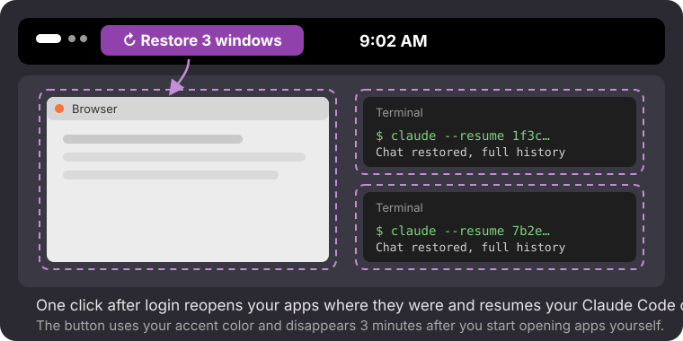

<p align="center"></p>

<h1 align="center">Session Restore for GNOME</h1>

<p align="center">GNOME forgets everything when you log out. This brings it back with one click:<br>
your apps, where their windows were, and your Claude Code chats.</p>

<p align="center"></p>

## What it does

- **Remembers your desktop.** While you work, it keeps a small record of which apps are
  open and where each window is: position, size, workspace, and whether it's maximized,
  fullscreen or minimized.
- **One-click restore.** After you log in, a **↻ Restore** button appears at the top
  left. Click it and your apps reopen, each window on the desktop it was on, at the same
  place and size. Desktops are recreated as needed, and if an app moves its own window
  right after opening (Firefox does), it's put back.
- **Brings back Claude Code chats.** Every [Claude Code](https://docs.anthropic.com/en/docs/claude-code)
  chat that was running reopens in its own terminal window, in the same folder, with its
  full history (`claude --resume`), on the desktop and at the spot where *that* chat was.
  Each chat is matched to its window by the title Claude gives the window. Plain terminals
  come back too, as fresh shells.
- **Survives reboots and reloads.** The offer is kept for the login it belongs to until you
  click it, dismiss it or it times out, even if the screen locks or GNOME reloads its extensions.
- **Gets out of the way.** The button uses your accent color (Settings → Appearance) and
  disappears 3 minutes after you start opening apps yourself. Apps that start
  automatically at login don't count. Locking and unlocking the screen doesn't bring it back.
  Click the small **×** beside it to skip restoring for this login.

## What it doesn't do

- It doesn't restore what's *inside* apps: tabs, documents, scroll positions. Many apps
  handle that themselves (in Firefox: Settings → General → *Open previous windows and tabs*).
- Unsaved work is still lost when you log out.
- Claude chats are reopened in **Ptyxis**, Fedora's default terminal. Other terminals need a
  small change to the `ptyxis` command in `extension.js`.
  `install.sh` turns off Ptyxis's own *Restore Session* option: it reopens old windows as
  empty shells, which would land where the chats belong.

## Install

Needs GNOME Shell 50 (tested on Fedora 44).

```bash
git clone https://github.com/aimanelahssini/gnome-session-restore
cd gnome-session-restore
./install.sh
```

Log out and back in once. Session Restore starts remembering from that login, and the
button appears from the following login on.

## Tests

`tests/shell/run.sh` opens fake Claude chats and a plain terminal in a throwaway headless
GNOME Shell, spreads them over desktops, saves, closes them, restores, and checks that each
window is back on its own desktop. Your real settings aren't touched.

## Privacy

Everything stays on your computer. The record is a single file,
`~/.local/state/session-restore/snapshot.json`, holding app IDs, window positions, and
for Claude Code chats the session ID and folder. It's overwritten as you work and is
never sent anywhere.

## Uninstall

```bash
gnome-extensions disable session-restore@aimanelahssini
rm -rf ~/.local/share/gnome-shell/extensions/session-restore@aimanelahssini ~/.local/state/session-restore
```

## License

MIT
